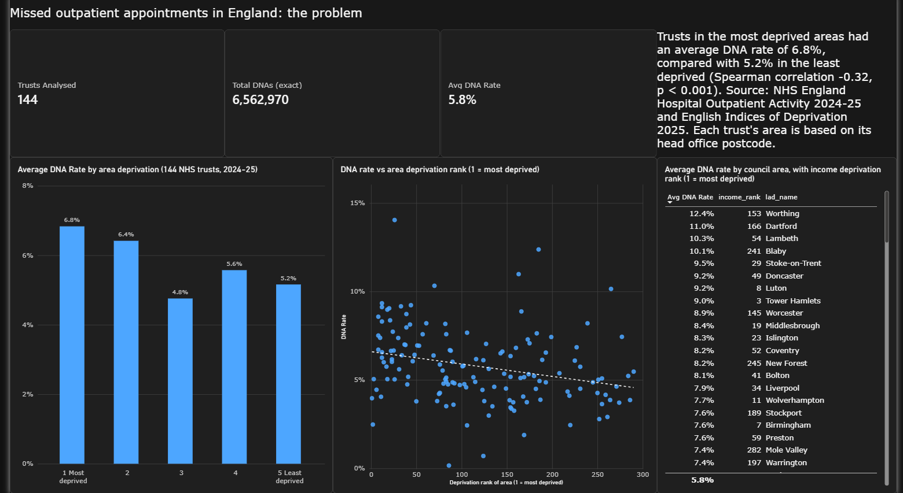
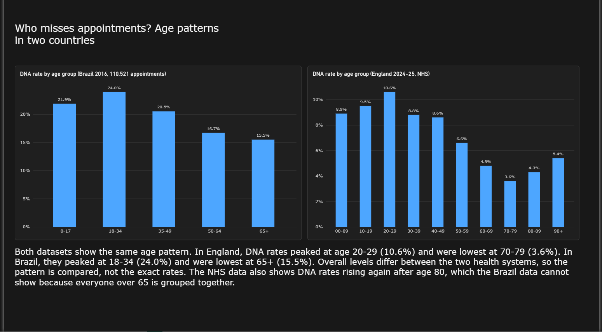
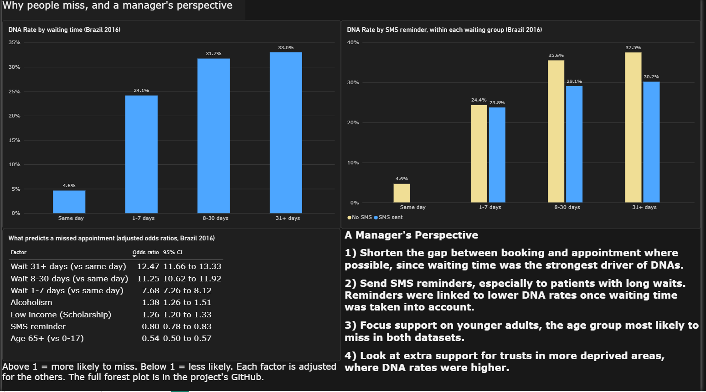
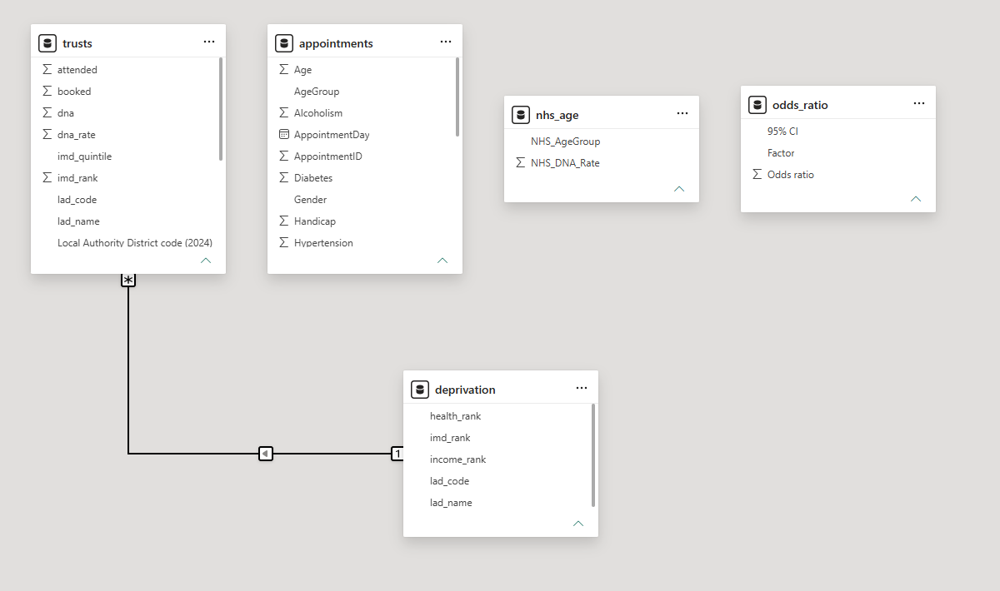
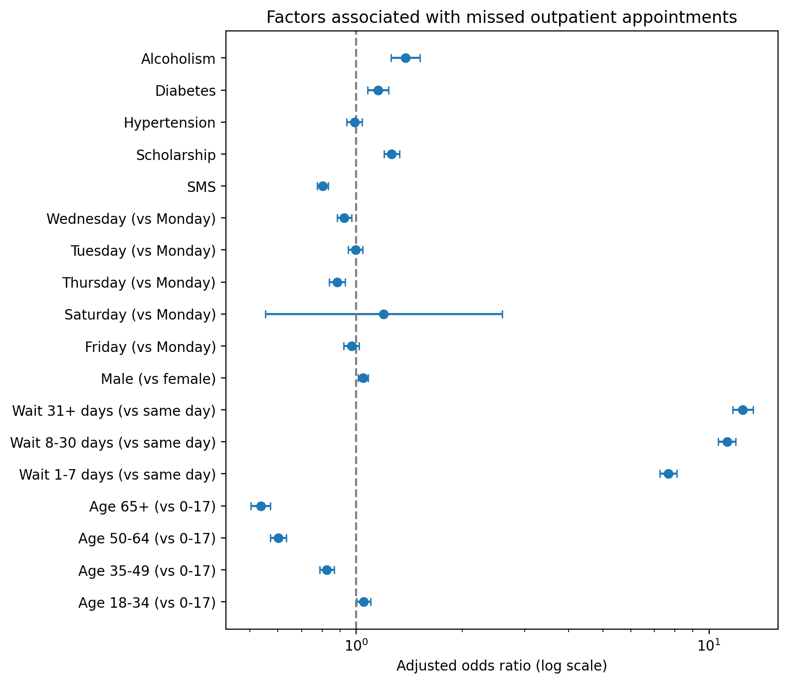
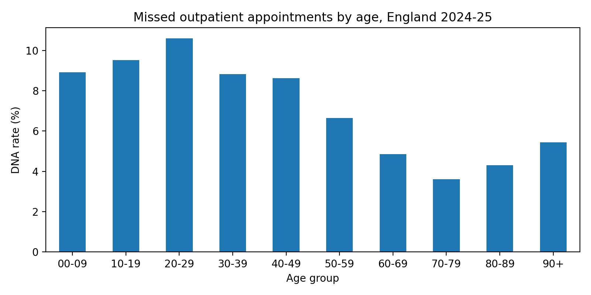

# Missed Outpatient Appointments: A Health Inequality?
An analysis of missed outpatient appointments (DNAs) in England, using NHS England 2024-25 data linked to the English Indices of Deprivation 2025, and 110,521 patient-level appointments from Brazil (2016).

**Built with:** Python (pandas, statsmodels, SciPy), SQL (SQLite), Power BI

## Key findings

- **Deprivation:** NHS trusts in the most deprived areas had an average DNA rate of **6.8%**, vs **5.2%** in the least deprived (Spearman -0.32, p < 0.001).
- **Age:** in both countries, young adults missed most and older adults least (England: 10.6% at age 20-29 vs 3.6% at 70-79).
- **Waiting time** was the strongest driver: 4.6% of same-day patients missed, vs 33.0% of those who waited 31+ days (adjusted OR 12.47).
- **SMS reminders** looked harmful at first (crude OR 1.90), because they were mainly sent to long-wait patients. After adjusting for waiting time, they were linked to **20% lower odds** of missing (OR 0.80). This is confounding.

## Documents

- [Case study (PDF)](Case%20Study.pdf): the full analysis, methods and limitations
- [Policy brief (PDF)](Policy%20Brief.pdf): a recommendation for an NHS trust board
- [Python notebook](dna_analysis.ipynb): cleaning, statistics, data linking and SQL
- [Power BI file](DNA_Dashboard.pbix): the dashboard
- [Trust-level data](nhs_trust_dna_deprivation.csv): 144 NHS trusts with DNA rates and deprivation ranks

## What I did

1. **Python:** cleaned the patient data (removed 6 impossible records), ran chi-square and Mann-Whitney tests, crude and adjusted odds ratios, and a multivariable logistic regression.
2. **Data linking:** calculated a DNA rate for each NHS trust, then linked trusts to postcodes, council areas and deprivation ranks.
3. **Data check:** accounted for all 1,286 providers in the NHS file, and fixed 3 trusts that failed to match because of 2024 council code changes. Final analysis: 144 trusts.
4. **SQL:** queried both datasets (SELECT, GROUP BY, CASE WHEN, JOIN). The results matched Python exactly.
5. **Power BI:** built a three-page dashboard, and linked a trusts fact table to a deprivation dimension table on council area code.

## Dashboard

| The problem | Who misses | Why, and a manager's perspective |
|---|---|---|
|  |  |  |

**Data model**

## Statistical results

| Factors linked to missed appointments | Age patterns in England |
|---|---|
|  |  |

## Limitations

- The deprivation finding compares **areas, not patients** (ecological analysis).
- Each trust's area is based on its head office postcode, but trusts serve wider populations.
- The patient-level data is from Brazil in 2016, so patterns are compared, not exact rates.
- Results show associations, not proof of cause.
- Mental health, community and acute trusts were not analysed separately.

## Data sources

- [NHS England, Hospital Outpatient Activity 2024-25](https://digital.nhs.uk/data-and-information/publications/statistical/hospital-outpatient-activity/2024-25)
- [English Indices of Deprivation 2025](https://deprivation.communities.gov.uk/download-all)
- [NHS Organisation Data Service, NHS trusts](https://digital.nhs.uk/services/organisation-data-service/data-search-and-export/csv-downloads/other-nhs-organisations)
- [Kaggle, Medical Appointment No Shows](https://www.kaggle.com/datasets/joniarroba/noshowappointments)
- [postcodes.io](https://postcodes.io)

## Tools

Python in Google Colab, SQL (SQLite) and Power BI. I used AI assistance to help write code, and checked and interpreted every result myself.

## License

© 2026 Ashlesha. All Rights Reserved. Shared for portfolio and demonstration purposes only. No part of this repository may be copied, reused or redistributed without written permission from the author.
